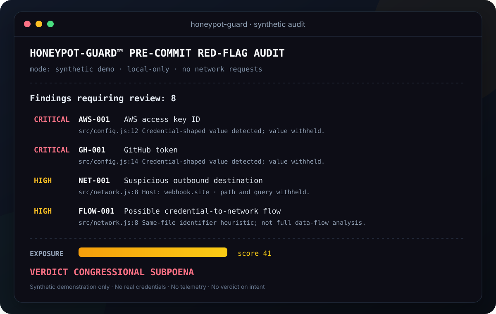
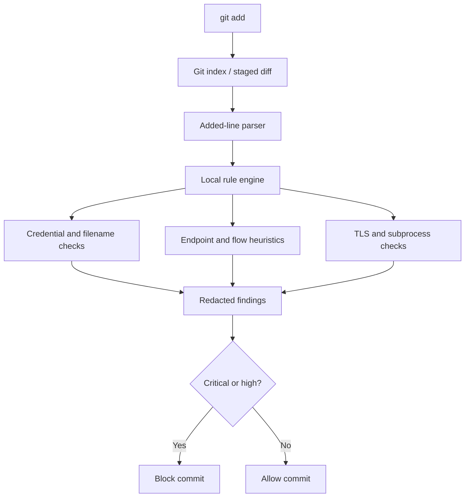

<div align="center">
  
  <h1>🍯 honeypot-guard</h1>
  <p><strong>Even $3 trillion in AI compute couldn't detect a red flag.<br/>Your pre-commit hook can.</strong></p>
  <p>
    
    
    
    <a href="LICENSE"></a>
  </p>
  <p><em>A local-first pre-commit red-flag scanner for leaked secrets, suspicious egress, and risky code patterns.</em></p>
</div>

---

## The 10-second audit

No API key. No account. No cloud upload. No local repository required for the synthetic demo. An internet connection is needed to fetch the CLI from GitHub.

After this repository is public, run:

```bash
npx github:voyager67/HoneyPot-Guard demo
```

This downloads the package from this GitHub repository and runs its demo command. Like **any** `npx` command that fetches remote code, it executes that code with your current user's permissions. npm may ask you to confirm installation; read the prompt and review the source before accepting. Do not run it as Administrator/root. The demo uses synthetic fixtures only: it does not inspect your project, change files, block a commit, or make network requests from the scanner itself. npm must still contact GitHub to fetch the package.

For a fully inspectable local run, clone the repository and execute:

```bash
npm run demo
```

No separate npm registry release is required for the GitHub-source command.

## What it checks

| Control | What it looks for | Default severity |
|---|---|---|
| Provider credential patterns | AWS, GitHub, OpenAI, Anthropic, Stripe, Slack, and Google key formats | Critical / high |
| Generic credential assignments | Literal values assigned to password, token, secret, API-key, and related fields | High |
| Populated environment files | Non-placeholder sensitive assignments in staged `.env*` files | High |
| Sensitive filenames | `.env`, private keys, certificates, and keystores staged for commit | Critical |
| Suspicious destinations | Outbound requests to request-catchers, tunnels, webhook collectors, and bot APIs | High |
| Endpoint policy | Literal IP destinations, plain HTTP, and hosts outside a configured allowlist | Medium |
| Credential-to-network heuristic | Sensitive environment-derived identifiers referenced in nearby outbound request lines | High |
| Risky execution settings | Disabled TLS verification and shell-enabled subprocess calls | Medium |

Findings include a location, explanation, and remediation. Credential values are never included in text, JSON, or SARIF output. URL paths, queries, and embedded URL credentials are withheld; endpoint findings show only the hostname.

**The tool reports signals, not verdicts.** A match does not prove a credential is valid, a host is malicious, or data was exfiltrated.

## Install in a project

Add the GitHub repository as a development dependency:

```bash
npm install --save-dev \
  github:voyager67/HoneyPot-Guard
```

Run a staged scan without blocking the commit:

```bash
npx honeypot-guard scan --staged \
  --dry-run
```

Install the managed Git pre-commit hook:

```bash
npx honeypot-guard install
```

The hook runs the locally installed executable and blocks commits containing critical or high findings. It does not download code on every commit. The installer refuses to overwrite an existing user hook. Remove only the hook it created with:

```bash
npx honeypot-guard uninstall
```

## Commands

```bash
# Screenshot-friendly synthetic demo (always exits 0)
npx honeypot-guard demo

# Scan additions in the Git index
npx honeypot-guard scan --staged

# Inspect real staged changes but do not block
npx honeypot-guard scan --staged \
  --dry-run

# Machine-readable output
npx honeypot-guard scan --staged \
  --format json
npx honeypot-guard scan --staged \
  --format sarif

# Choose the minimum severity that blocks a commit
npx honeypot-guard scan --staged \
  --fail-on critical
npx honeypot-guard scan --staged \
  --fail-on medium
npx honeypot-guard scan --staged \
  --fail-on never

# Use a different policy file
npx honeypot-guard scan --staged \
  --config config/security-policy.json
```

| Exit code | Meaning |
|---:|---|
| `0` | No finding meets the blocking threshold, or demo/dry-run mode was used |
| `1` | A finding meets the blocking threshold |
| `2` | Git, configuration, argument, or hook installation error |

The default `--fail-on high` blocks critical and high findings. Medium findings remain visible but do not block by default. `--fail-on critical` blocks only critical findings; `--fail-on never` reports without blocking.

## Policy configuration

Copy `.honeypot-guard.json.example` to `.honeypot-guard.json` in the root of the repository. When installed as a dependency, the template is available at `node_modules/honeypot-guard/.honeypot-guard.json.example`:

```json
{
  "allowedHosts": [
    "api.github.com",
    "*.internal.example"
  ],
  "ignoredPaths": [
    "docs/fixtures/**",
    "generated/**"
  ],
  "disabledRules": []
}
```

- `allowedHosts` accepts exact hostnames and `*.subdomain` patterns. A wildcard matches subdomains, not the apex domain.
- `ignoredPaths` accepts repository-relative `*`, `?`, and `**` patterns.
- `disabledRules` disables rules by ID. Keep exceptions narrow and review policy changes.
- An invalid JSON file, unknown field, or invalid field type fails closed with an error.

An individual added line can be suppressed with `honeypot-guard:ignore`:

```js
const trainingValue = "synthetic-fixture-value"; // honeypot-guard:ignore
```

Suppressions are not reviewed by anyone. Treat each one as a documented risk acceptance, not a fix.

## How it works



**Scope by design:** Honeypot Guard reads staged additions and staged filenames. It does not scan unstaged edits, untracked files, deleted content, full Git history, dependencies, or the working tree as a whole.

## Why another scanner?

Honeypot Guard is intentionally narrow: it checks the change at the moment it is about to enter Git history and adds lightweight context around outbound network calls. Its credential-to-network rule is a same-file identifier heuristic with a bounded line window—not compiler-grade data-flow analysis.

It is **not** a replacement for dedicated secret scanners, secret managers, SAST, dependency scanning, or code review. Use established tools such as [Gitleaks](https://github.com/gitleaks/gitleaks) or [TruffleHog](https://github.com/trufflesecurity/trufflehog) alongside it when their broader capabilities are needed. This project does not claim to outperform them.

## Research protocol

The research question is:

> Can lightweight context-aware analysis over staged changes identify potentially risky credential-to-network patterns beyond line-level secret matching, while keeping false positives and pre-commit latency acceptable?

[`docs/RESEARCH.md`](docs/RESEARCH.md) defines synthetic positive and negative controls, transformation experiments, baselines, metrics, and a reproducible reporting template. **No benchmark accuracy claims are published here.** Results should be added only after experiments have been run and independently reproduced.

## Development

Requirements: Node.js 18.12+ and Git. Runtime dependencies: **zero**.

```bash
git clone \
  https://github.com/voyager67/HoneyPot-Guard.git
cd HoneyPot-Guard
npm test
npm run demo
npm run check
```

Tests use synthetic credentials assembled at runtime and temporary Git repositories. They do not use real secrets or contact external endpoints.

## Security and limitations

- Local-only operation: the scanner makes no network requests and sends no telemetry.
- Staged-diff scope: only added lines and staged filenames are inspected.
- Pattern-based detection: provider formats change, and not every credential or endpoint will match.
- Heuristics can produce false positives and false negatives.
- Credential-to-network analysis is not full program analysis.
- No credential verification, revocation, or transmission is attempted.
- If a real credential was committed or exposed, rotate/revoke it. Removing it in a later commit does not make it safe again.

Read [`SECURITY.md`](SECURITY.md) before reporting a vulnerability.

## Contributing

Focused issues and pull requests are welcome. Add synthetic regression tests for new rules, ensure all reports remain redacted, and include a negative control to check false positives. See [`CONTRIBUTING.md`](CONTRIBUTING.md).

## License

MIT. See [`LICENSE`](LICENSE).

---

<div align="center">
  <strong>Governance has entered the chat.</strong><br/>
  <sub>Honeypot Guard reports red flags. It does not provide legal advice, employment advice, or emotional support.</sub>
</div>
